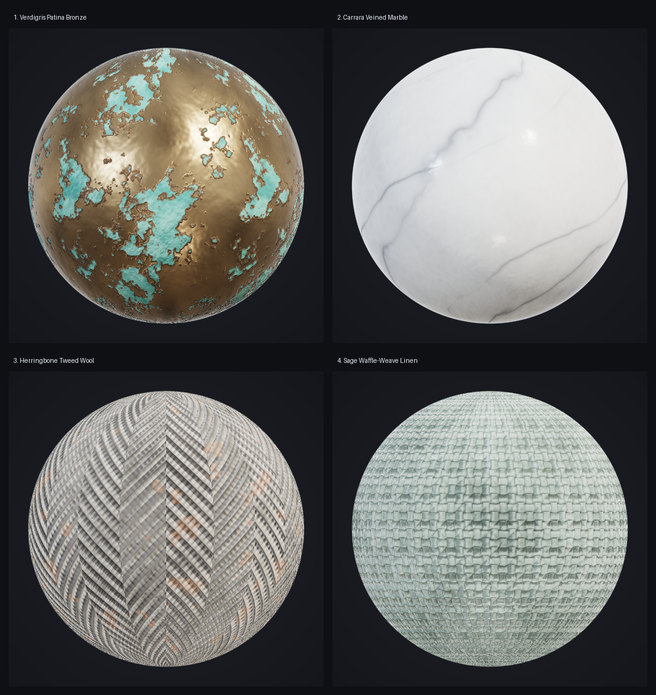
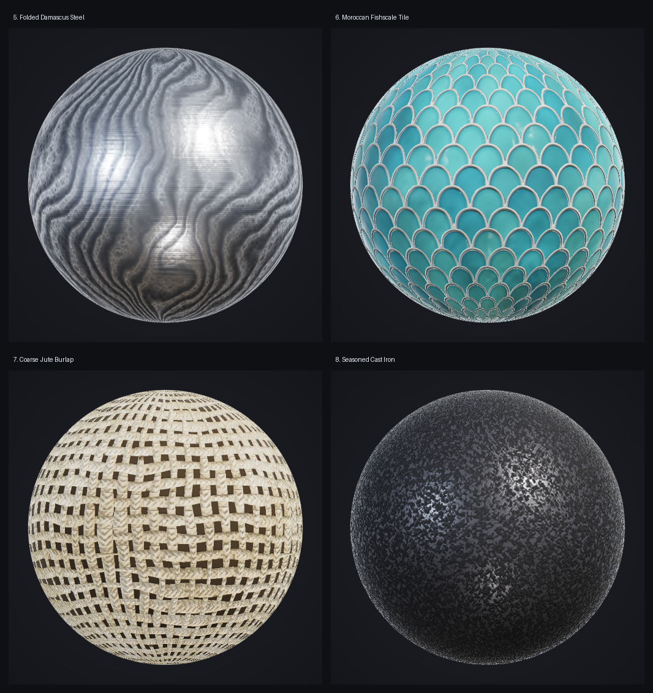
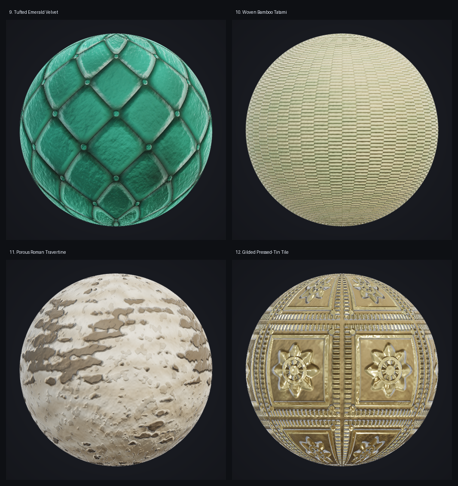

# hypbr

**Hybrid Neural + Exact Periodic Procedural PBR Material Synthesizer**

`hypbr` synthesizes seamlessly tileable, physically calibrated **15-map PBR material sets** (glTF 2.0 ORM, 16-bit height, OpenGL/DirectX tangent normals, 8-azimuth horizon-based AO, bent normals, curvature, anisotropy, specular, and subsurface thickness) at arbitrary resolution with zero border seams.

- **Exact Periodic Procedural Synthesis**: Pure NumPy/PyTorch circular-padded microstructure generators across metals, stones, ceramics, fabrics, wood, and hard-surface panels — ~0.35s per material with `0.00 px` seam error.
- **47-Node Composable PBR Graph**: Editable JSON node graph with analytic bevels, Weickert structure tensors, Reoriented Normal Mapping (RNM), 8-azimuth Horizon-Based Ambient Occlusion (HBAO) + Bent Normals, and Kaplanyan/Toksvig Specular Anti-Aliasing.
- **Optional Neural Photo-to-PBR**: Calibrate real macro photographs through **Apple Depth Pro** (metric depth prior) and **DeepBump ONNX** (micro-relief tangent normals) before feeding into the circular-padded 47-node graph.

<p align="center">
  
</p>
<p align="center">
  
</p>
<p align="center">
  
</p>

## Installation

```bash
git clone https://github.com/wrong-nebula/hypbr.git
cd hypbr
pip install -e .
```

For neural photo-to-PBR (`hypbr photo`), also install the optional neural extras and Apple Depth Pro:

```bash
pip install -e ".[neural]"
```

## Quick Start (CLI)

List built-in procedural materials:

```bash
hypbr list
```

Synthesize a single seamless 15-map PBR material at `1024x1024`:

```bash
hypbr synth verdigris_patina_bronze --size 1024 --out ./output/pbr
```

Synthesize a machined hard-surface panel (`hardops_plate`):

```bash
hypbr synth hardops_plate --size 512 --out ./output/pbr
```

Synthesize the full built-in procedural catalog:

```bash
hypbr synth all --size 512 --out ./output/pbr
```

Export and inspect a 47-node PBR graph preset as JSON:

```bash
hypbr dump-preset v13-default > my_graph.json
```

Convert a macro photograph to 15 seamless PBR maps (requires optional Depth Pro + ONNX Runtime):

```bash
hypbr photo path/to/surface.jpg --preset v13-default --tileable --out ./output/photo_pbr
```

## Python API Examples

### 1. Synthesize Seamless PBR Materials

```python
from hypbr import list_materials, synthesize_material

for item in list_materials()[:5]:
    print(item["id"], "-", item["category"])

out_dir = synthesize_material(
    "damascus_folded_steel",
    out_dir="./output/damascus",
    size=1024,
    seed=42,
)
print("Saved 15 PBR maps to:", out_dir)
```

### 2. Inspect or Customize the Node Graph

```python
import json
from hypbr import PRESETS

graph = PRESETS["v13-default"]
print(f"Nodes in v13-default: {len(graph['nodes'])}")
with open("custom_graph.json", "w") as f:
    json.dump(graph, f, indent=2)
```

See runnable scripts in [`examples/synthesize_pbr.py`](examples/synthesize_pbr.py) and [`examples/custom_graph.py`](examples/custom_graph.py).

## Output Maps

Every material synthesis writes a clean, renderer-ready directory compatible with **glTF 2.0**, **Three.js**, **Blender**, **Unreal Engine**, and **Unity**:

| File | Bit Depth / Channels | Description |
|---|---|---|
| `albedo_delit.png` | 8-bit sRGB | De-lit physical base color |
| `normal.png` | 8-bit RGB | Tangent-space normal map (OpenGL `+Y`, optional DirectX `-Y`) |
| `bent_normal.png` | 8-bit RGB | Average unoccluded hemisphere direction from 8-azimuth HBAO |
| `height.png` | 8-bit Gray | Linear displacement / POM heightmap |
| `height16.png` | 16-bit Gray | Precision 16-bit linear heightmap (zero banding) |
| `ao.png` | 8-bit Gray | 8-azimuth Horizon-Based Ambient Occlusion |
| `roughness.png` | 8-bit Gray | Physical roughness with Toksvig Specular AA |
| `metallic.png` | 8-bit Gray | Physical metallic mask |
| `orm.png` | 8-bit RGB | Packed glTF 2.0 texture (`R=AO, G=Roughness, B=Metallic`) |
| `curvature.png` | 8-bit Gray | Multi-scale signed curvature (0.5 neutral) |
| `cavity.png` | 8-bit Gray | Concave crevice mask |
| `edge_wear.png` | 8-bit Gray | Convex ridge wear mask |
| `anisotropy.png` | 8-bit RGB | Tangent flow direction + anisotropy strength |
| `specular.png` | 8-bit Gray | Dielectric specular level / F0 modulation |
| `thickness.png` | 8-bit Gray | Inverted ambient thickness for subsurface scattering |
| `preview.png` | 8-bit sRGB | Shaded studio preview |

## Architecture

- [`hypbr/procedural.py`](hypbr/procedural.py): Exact periodic FBM, Voronoi, weave, tile, and metal microstructure heightfield generators.
- [`hypbr/normal_graph.py`](hypbr/normal_graph.py): Composable 47-node PBR graph engine (RNM blending, Weickert structure tensors, analytic SDF bevels, 8-azimuth HBAO + bent normals, Toksvig Specular AA, ORM packing).
- [`hypbr/synthesize.py`](hypbr/synthesize.py): High-level material synthesis API combining periodic heightfields, physically based multi-tone albedo/metallic rules, and the 15-map export pipeline.
- [`hypbr/depthpro_pbr.py`](hypbr/depthpro_pbr.py): Optional Apple Depth Pro + DeepBump ONNX neural depth/normal extraction with 4-rotation perspective cancellation and circular padding.
- [`hypbr/cli.py`](hypbr/cli.py): `hypbr` command-line interface.

## License

Code is released under the [MIT License](LICENSE).

> **Note on optional neural weights:** If you use the optional `hypbr photo` neural mode with Apple Depth Pro checkpoints, those external weights are subject to Apple's `apple-amlr` research license. Pure procedural synthesis (`hypbr synth`) has zero external model dependencies and is 100% MIT licensed.
